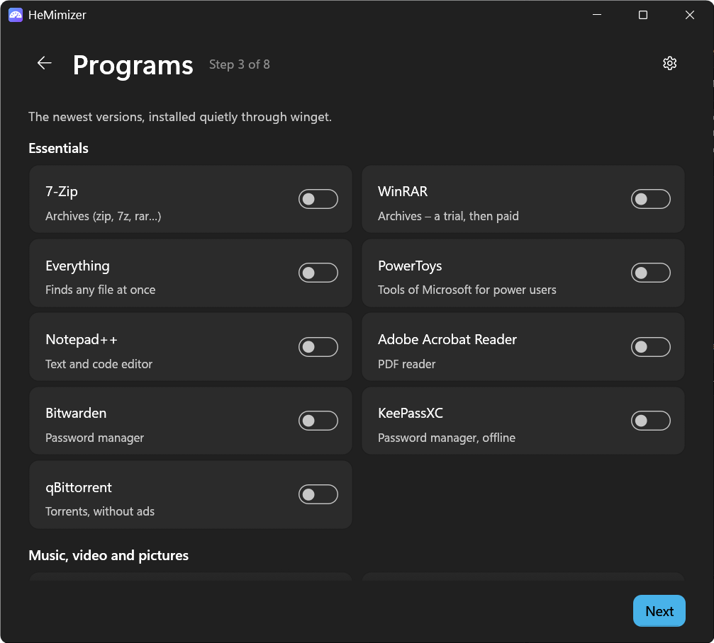

#  HeMimizer

   

Gets a freshly installed Windows ready: the **drivers** for your hardware, the **programs** you choose, the **settings** of your
old PC and a **cleaner Windows** – in one go, after a short wizard.

**[Download](https://github.com/Hemal1k/HeMimizer/releases/latest)** · [Project page](https://hemal1k.github.io/hemimizer.html) · [Report a problem](https://github.com/Hemal1k/HeMimizer/issues)

> The downloads are not code-signed, so Windows SmartScreen may warn the first time (More info → Run anyway). Each release has `SHA256SUMS.txt` to check them.
> HeMimizer changes Windows a lot and runs as administrator – use it on a new installation; the first step can be a restore point.

## How it works

1. **Before reinstalling:** start HeMimizer on the old PC and choose **Back up this PC**. The wizard asks what the new Windows
   gets, and HeMimizer saves it with your settings (and, if you like, all installers) into a folder – a USB stick or a network
   drive is best. HeMimizer copies itself there too.
2. **After reinstalling:** start `HeMimizer.exe` from that folder and choose **Set up this PC**. It installs the drivers, then
   the programs, puts the settings back and cleans Windows up – also across restarts.

Without a backup, **Set up this PC** runs the same wizard on the new PC.

## The wizard

| Page | What you choose |
|---|---|
| Drivers and the software of the maker | Ticked by the hardware found: NVIDIA graphics, AMD chipset / Radeon graphics, Intel drivers; for a laptop or a ready-made PC its maker's tool (HP Support Assistant, Lenovo Vantage, MyASUS, Dell, Acer, MSI), for a PC built from parts the tool of its motherboard (Armoury Crate, MSI Center). |
| Browser | One more besides Microsoft Edge (Chrome, Firefox, Brave, Opera, Vivaldi) – or none. |
| Programs | About 60 programs in sections, with a search: 7-Zip, VLC, Steam, Epic, Ubisoft Connect, EA app, Discord, Spotify, LibreOffice, VS Code, Git, Python, the free creative apps of ArtCraft… and HeMi Launcher. |
| Windows | Over 30 changes, each a switch, in groups: clean-up, privacy and AI, the taskbar and Start, File Explorer, system and games, updates. A starting point: recommended, like this PC (read from the old PC), or change nothing. |
| Settings to take along | From the old PC – Windows: wallpaper, colours, pinned apps, File Explorer, Microsoft Defender, network drives, display scaling, Notepad; your programs (only the ones chosen): VLC, qBittorrent, Brave, Steam, AMD Software, 7-Zip, Notepad++, PowerToys, OBS, ShareX, VS Code, Git, GIMP, LibreOffice, Thunderbird… |
| Your folders | Own folders copied into the backup and put back to their place. |
| Where to save | The folder of the backup, the installers now (for a setup offline), the name of the PC – and a summary. |

Programs with their own licence terms are listed at the setup, each with a link: HeMimizer installs them only after you
accept, or leaves them out.

The programs come through **winget** (the package manager of Windows), the HeMi apps from their GitHub releases, the AMD drivers
from amd.com. Nothing else is sent anywhere.

## Download

| File | For |
|---|---|
| `HeMimizer.exe` | The program for x64 – one file, run it from any folder (it asks for administrator rights). |
| `HeMimizer-arm64.exe` | The same for Windows on ARM. |

Windows 11 (Windows 10 mostly works). Also in [HeMi Launcher](https://github.com/Hemal1k/HeMiLauncher).

## Build

Rust (stable, MSVC). `cargo build --release` gives `build\release\HeMimizer.exe`; `.\release.ps1` builds both downloads
(the GitHub workflow does the same for every release). A debug build runs without administrator rights, for trying the window.

| Folder | What |
|---|---|
| `src\app.rs` | The window: the first page, the wizard, the backup, the run and its result. |
| `src\catalog.rs`, `src\hardware.rs`, `src\plan.rs` | What the wizard offers, what the PC is, what was chosen (`plan.json` in the backup). |
| `src\install.rs` | Installs what was chosen: from the installers of the backup or through winget. |
| `src\steps.rs`, `src\windows.rs`, `src\debloat.rs`, `src\programs.rs`, `src\drivers.rs` | The steps of the setup. |
| `src\backup.rs`, `src\config.rs` | The backup: settings, installers, own folders. |

## License

[MIT](LICENSE). The parts of others are listed in `assets\ThirdPartyNotices.txt` (also in the program: Settings → Licences).
